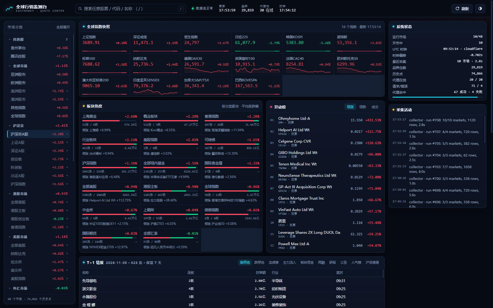
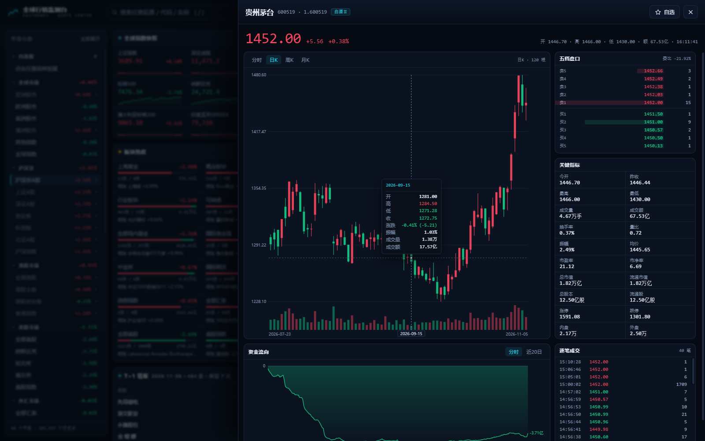
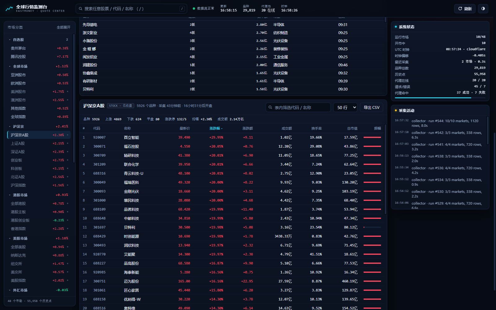
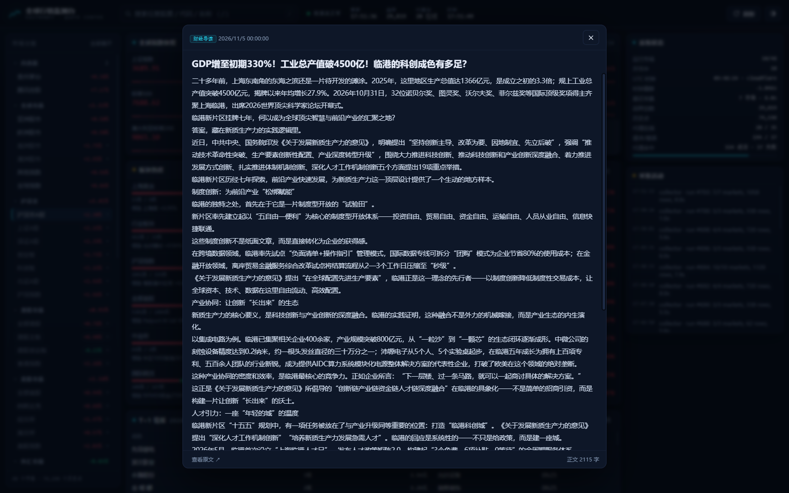
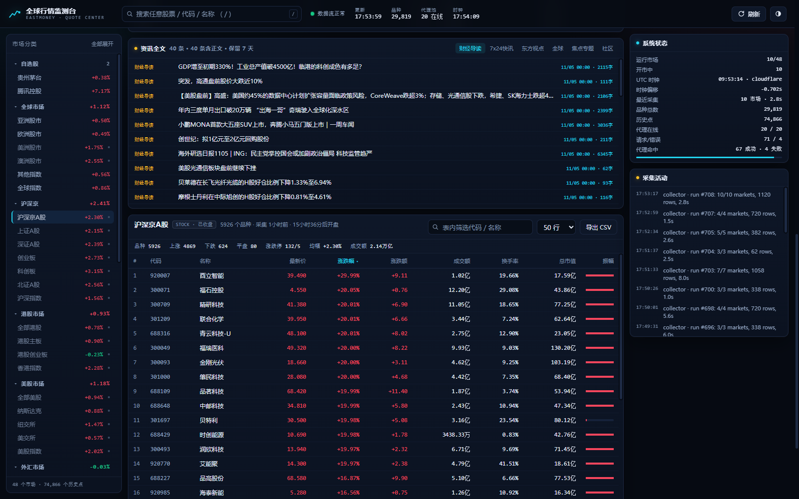

# Global Market Terminal · 全球行情监测台

A self-hosted market monitor for EastMoney: 48 markets across 10 regions, a
single-stock terminal, a T+1 intelligence layer, and an evidence protocol an LLM
agent can query without reading a single web page.

Runs on the Python standard library alone. No framework, no build step, no LLM
inside — the model you attach decides what the numbers mean; this thing gathers
and delivers them.



---

## What it does

**Global overview** — indices, sector heat, movers and a full instrument table for
48 markets, from A-shares and Hong Kong to US, Europe, Asia-Pacific, FX, futures,
commodities and bonds. Each market has a real trading calendar, so the collector
never polls a closed exchange.

**Single-stock terminal** — order book, intraday trend, daily/weekly/monthly
candles, capital flow, tick prints and a watchlist. Every chart is interactive:
hover to get a crosshair with the exact bar values, not just a line.



**T+1 intelligence** — ten scraped feeds chosen for next-session relevance:
limit-up and limit-down pools, the dragon-tiger list, main capital flow, sector
rotation, northbound flows, margin balances, announcements, broker research and
retail popularity. Stored by trading day, pruned at seven days.



**Full-text news** — six EastMoney sections (财经导读, 7x24快讯, 东方视点, 全球,
焦点专题, 社区) with the article body extracted, so you read the piece in place
instead of bouncing to the source site.



**Agent protocol** — every query takes an `as_of` cutoff and returns typed facts
with units, source ids and an explicit caveat list. Signals are filtered by their
*publication* hour, so a replay at 15:00 sees the limit-up pool but not the
17:30 dragon-tiger list. Predictions can be written back and are scored against
realised returns.



---

## Why it is built this way

Three constraints shaped the design, and each one is a tradeoff worth knowing:

**Markets are not all open.** A naive loop over 48 markets wastes most of its
requests and gets rate-limited. Each market carries a session calendar (26 of
them, DST-aware), and the collector only touches what is trading. When everything
is closed it idles at 30 s instead of hammering idle endpoints.

**The clock cannot be the local one.** T+1 reasoning depends on knowing whether a
session has actually closed. Time is synced from Cloudflare, then `timeapi.io`,
then EastMoney's own `Date` header, with RTT/2 compensation and a monotonic
anchor. If the clock goes stale the collector degrades deliberately rather than
guessing.

**EastMoney rate-limits by IP.** The dynamic proxy pool refreshes a batch every
cycle, ranks proxies by latency EMA, and evicts after three failures. Interactive
requests hedge: a single-stock payload gets a 1 s budget, and only stragglers are
duplicated rather than all four calls.

---

## Quick start

Requires Python 3.11+ (3.13 tested) on Windows, Linux or macOS.

```bash
git clone <your-repo-url> eastmoney-monitor
cd eastmoney-monitor

python -m venv .venv
source .venv/bin/activate          # Windows: .venv\Scripts\activate
pip install -r requirements.txt

cp .env.example .env               # then edit it (see Configuration)
python run.py init                 # schema + 48 market definitions
python run.py collect --klines     # one full pass, about 2 minutes
python run.py run                  # collector loop + dashboard
```

Open <http://127.0.0.1:8787>.

Other commands:

```bash
python run.py collect --only global.asia,us.index   # a subset
python run.py serve                                 # dashboard only, no polling
python run.py status                                # per-market health table
python run.py proxy --test                          # extract and probe the proxy pool
```

Background start/stop on Windows:

```powershell
.\scripts\start.ps1              # detached, logs to logs\run.out, waits for /api/health
.\scripts\start.ps1 -Port 9000
.\scripts\stop.ps1
```

---

## Configuration

Everything lives in `.env`; real environment variables win over the file.

| Variable | Default | Meaning |
| --- | --- | --- |
| `dmdaili_apikey` / `dmdaili_pwd` | — | Proxy provider credentials. Leave empty to run direct. |
| `EM_USE_PROXY` | `1` | Set `0` to bypass the pool entirely. |
| `EM_PROXY_BATCH` | `20` | IPs fetched per refresh |
| `EM_PROXY_TARGET` | `20` | Pool size to maintain |
| `EM_PAGE_SIZE` | `100` | EastMoney caps list pages at 100 |
| `EM_WORKERS` | `8` | Concurrent page fetches |
| `EM_RATE` | `10` | Requests per second, global |
| `EM_TIMEOUT` | `6` | Per-request timeout (s) |
| `EM_RETENTION_HOURS` | `24` | Intraday quote history kept |
| `EM_SIGNAL_DAYS` | `7` | Signals, articles and predictions kept |
| `EM_KLINE_HOURS` | `6` | Daily-bar refresh interval |
| `EM_IDLE_SLEEP` | `30` | Idle delay when every market is closed |
| `EM_HOST` / `EM_PORT` | `127.0.0.1` / `8787` | Dashboard bind address |

Without proxy credentials the platform still runs; it just falls back to direct
requests and will be rate-limited sooner.

---

## Architecture

```
run.py          CLI: init / collect / serve / run / status / proxy
collector.py    session-aware collection loop, per-market page fan-out
markets.py      48 market definitions (secid filters, intervals, calendars)
sessions.py     26 trading calendars, DST via tzdata, BASKETS per region
timesync.py     multi-source clock with RTT compensation and staleness guard
proxy_pool.py   rotating proxy pool: latency EMA, scoring, eviction
em_client.py    HTTP client: keep-alive, gzip, hedging, common API surface
feeds.py        ten T+1 signal feeds, normalised records
signal_hub.py   schedule for those feeds (intraday window vs evening publishes)
intel.py        news sections, article bodies, 7-day store
evidence.py     point-in-time evidence packets + prediction scoring
server.py       HTTP server, JSON API, static UI
mcp_server.py   MCP binding over the same HTTP contract
db.py           SQLite schema, readers, retention
web/            vanilla JS dashboard (no build step)
```

**Data flow.** The collector fans out per market, writes to SQLite (WAL, one
writer, read-only connections per thread), and keeps a hot in-memory cache so the
dashboard is a cache read. Background hubs add signals and article bodies on their
own cadence. The API is a read model over that database; live per-stock reads go
upstream on demand and are cached.

**Storage.** One SQLite file. Intraday ticks, bars, quotes, signals, articles and
predictions each prune on their own schedule.

---

## API

Two surfaces over the same data.

**`/api/*` — operational.** Markets, rows, movers, search, stock snapshot, K-line
bars, signals, news, watchlist, status.

**`/api/v1/*` — agent protocol.** Evidence packets with `as_of`:

| Endpoint | Returns |
| --- | --- |
| `GET /api/v1/meta` | schema version, units, field glossary |
| `GET /api/v1/regime?as_of=` | breadth, limit-up pool, sector flows, connect, margin |
| `GET /api/v1/candidates?as_of=` | names ranked by signal confluence, with reasons |
| `GET /api/v1/stock/{secid}/evidence?as_of=` | price, momentum, signals, related news |
| `GET /api/v1/news/search?q=&as_of=` | full-text search over seven days |
| `POST /api/v1/predictions` | record a call for scoring |
| `GET /api/v1/predictions/scorecard` | hit rate, Brier score, calibration |
| `GET /api/v1/openapi.json` | OpenAPI 3.1 description |

Enumerate the universe with `GET /api/instruments?page=1&size=1000` (29,834
symbols, 30 pages), filter with `market=`, `kind=`, `q=`. Bars take an explicit
range: `GET /api/stock/1.600519/kline?klt=101&from=2026-09-01&to=2026-09-30`.

Details: [agent protocol](docs/agent-protocol.md),
[API audit](docs/api-audit.md),
[capabilities](docs/api-capabilities.md),
[delivery report](docs/api-delivery-report.md).

### MCP

```bash
python mcp_server.py --selftest     # tool manifest + live check
python mcp_server.py                # stdio transport
```

Eight tools — `market_regime`, `screen_candidates`, `stock_evidence`,
`search_news`, `read_article`, `list_signals`, `report_prediction`, `scorecard` —
over the same HTTP contract, so a plain HTTP client and an MCP host see identical
data.

---

## Testing

```bash
python tests/test_sessions.py        # 25 trading-calendar boundary assertions
python scripts/audit_api.py          # 30 endpoints, browser vs plain-Python UA
python scripts/audit_delivery.py     # K-lines verified field-by-field vs upstream
python scripts/check_capabilities.py # enumeration, time, symbol and dependency checks
```

The delivery audit compares served bars against EastMoney itself: 591 closed bars
across A-share, index, HK and US instruments, zero mismatches.

---

## Notes and limitations

- **Market holidays are not modelled.** Weekends and session hours are exact; a
  public holiday looks like a closed market with stale data. Documented, not hidden.
- **The newest bar can be forming.** Responses carry `last_final` and a `note` so
  a caller can tell a settled bar from one still moving.
- **HK fund-flow figures use a different caliber** and are flagged
  `flow_reliable: false` rather than shown as if comparable.
- **Northbound net inflow is no longer disclosed** by the exchanges; only turnover
  is available, and the API labels it as such.
- **Community posts** come from the server-rendered 股吧 list pages. The market-wide
  JSON endpoint returns an empty array to unauthenticated clients.
- **The proxy tunnels HTTP only**; HTTPS CONNECT is unsupported by the provider, so
  EastMoney calls go over `http://` when routed through the pool.
- **Not investment advice.** Data is scraped from public EastMoney endpoints for
  personal analysis. Respect the site's terms and your local regulations.

---

## Project structure

```
.
├── run.py                 CLI entry point
├── collector.py           collection loop
├── markets.py             market definitions
├── sessions.py            trading calendars
├── timesync.py            clock sync
├── proxy_pool.py          proxy rotation
├── em_client.py           EastMoney HTTP client
├── feeds.py               T+1 signal feeds
├── signal_hub.py          signal scheduler
├── intel.py               news + article bodies
├── evidence.py            evidence packets, prediction scoring
├── server.py              HTTP API + static server
├── mcp_server.py          MCP binding
├── db.py                  SQLite layer
├── config.py              settings
├── web/                   dashboard (index.html, app.js, styles.css)
├── scripts/               start/stop helpers + audits
├── tests/                 calendar tests
├── docs/                  protocol and audit reports, screenshots
└── requirements.txt
```

---

## License

No license has been chosen for this repository yet. Add one before distributing
it — without a license, default copyright applies and others may not reuse it.
